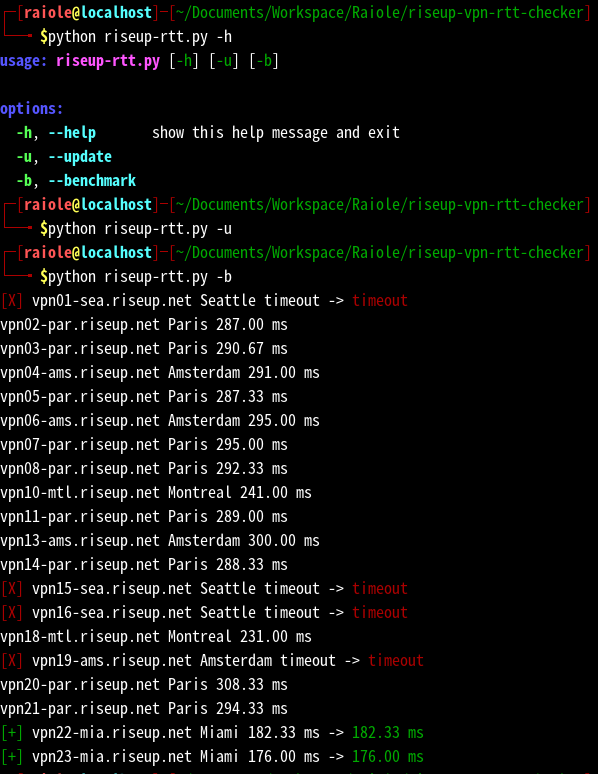

# riseup-vpn-rtt-checker

## About

This Python script only measures RTTs to RiseupVPN servers and has no other functionality.

## Usage

`riseup-rtt.py` accepts the following command-line options:

- `-u`, `--update`: Download or update `gateways.json`.
- `-b`, `--benchmark`: Measure RTTs to RiseupVPN servers.

The script marks servers with an RTT of 200 ms or under as good and displays the RTT value in green.

If a server times out, it is marked as bad and its status is displayed in red.

## Use Case
I made this script to check the RTT of RiseupVPN servers in Termux. I also made it as part of my rehabilitation.

You can check the RTT manually in Termux, but it takes time. This script lets you check it quickly whenever and wherever you have Termux.

It is useful when you want to check the RTT of a RiseupVPN server right away.
